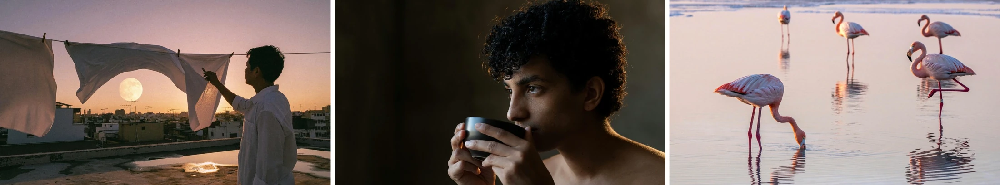

  

# Awesome MiniMax H3 Image Prompts

MiniMax H3 Image prompts, images and editing references, curated by [BeatAPI](https://beatapi.io).

**[Browse the prompt gallery](https://beatapi.io/minimax-h3-image-prompts)** · **[H3 video gallery](https://github.com/BeatAPI/awesome-minimax-h3-prompts)** · **[中文说明](./README.zh-CN.md)** · **[Contribute a prompt](https://github.com/BeatAPI/awesome-minimax-h3-image-prompts/issues/new?template=prompt.yml)**

**60 examples · 106 result images · 10 reference inputs.** Includes 5 complete prompt examples and 55 showcases.

**Browse by use case:** [Official workflows](./prompts/use-cases/official-workflows.md) · [Photography](./prompts/use-cases/photography.md) · [Image editing](./prompts/use-cases/image-editing.md) · [Art & illustration](./prompts/use-cases/art-illustration.md) · [Typography](./prompts/use-cases/typography.md) · [Instruction following](./prompts/use-cases/instruction-following.md) · [Prompt comparison](./prompts/use-cases/prompt-comparison.md) · [Multi-turn editing](./prompts/use-cases/multi-turn-editing.md)

### 1. Farm-to-table feast · official workflow

[@MiniMax_AI](https://x.com/MiniMax_AI)

<strong>Original prompt</strong>

~~~~text
A rustic, overhead shot of a farm-to-table feast, showcasing a variety of colorful, seasonal vegetables, artisanal cheeses, and freshly baked bread on a weathered wooden table.
~~~~

[Official expansion and generation workflow](https://huggingface.co/MiniMaxAI/MiniMax-H3-Image#full-workflow)

---

### 2. Podcast fist bump · official editing workflow

[@MiniMax_AI](https://x.com/MiniMax_AI)

<strong>Original prompt</strong>

~~~~text
Take the over-ear headphones off the man on the left and fill in his hair where the band flattened it. Have both hosts lean toward each other and fist-bump directly above the "MONEY TALKS" desk sign, knuckles touching, elbows lifted off the desk, so the bump sits dead centre between the two microphones.
~~~~

[Official expansion and generation workflow](https://huggingface.co/MiniMaxAI/MiniMax-H3-Image#full-workflow)

Reference inputs

---

### 3. Cyberpunk courier in Tokyo

[@PrometheanAIX](https://x.com/PrometheanAIX/status/2120158081187262682)

<strong>Original prompt</strong>

~~~~text
Ultra-realistic cinematic portrait of a male cyberpunk courier sprinting through a futuristic Tokyo street. The camera is two feet above the sidewalk, ten feet away, angled upward. He leans aggressively forward, almost 45 degrees, eyes focused ahead, not at the camera. Spiky hair rendered photorealistically, technical runner's clothing with subtle cyan and magenta accents. The city feels modern and futuristic, but not dirty or grim, restrained neon glow, dynamic motion, shallow depth of field. Three-by-four aspect ratio.
~~~~

---

### 4. Sandwich repair attempt

[@amrstech](https://x.com/amrstech/status/2120191390797930765)

<strong>Original prompt</strong>

~~~~text
Join and make it a while original realistic sandwich. There must be no cuts , it must be whole as before split.
~~~~

Reference inputs

---

### 5. Moonlit library in Arabic

[@Malzahran2](https://x.com/Malzahran2/status/2120180332833976422)

<strong>Original prompt</strong>

~~~~text
غرفة مكتبة قديمة ضخمة في الليل، ضوء قمر يدخل من نافذة كبيرة مكسورة، فتاة تجلس على الأرض محاطة بكتب مفتوحة طائرة في الهواء (حوالي 15 كتاب)، كل كتاب مفتوح على صفحة مختلفة فيها رسومات وخطوط، قطة بيضاء تقفز من كتاب إلى آخر، الغبار يتطاير في شعاع الضوء، تفاصيل الخشب القديم والورق الممزق واضحة جدًا، إضاءة درامية عالية التباين.
~~~~

---

### 6. Birthday on disposable film

[@frankzaga24](https://x.com/frankzaga24/status/2120191917254119803)

Image showcase. See the original post for prompts and workflow details.

---

### 7. MoonPay campaign concepts

[@nicravesh](https://x.com/nicravesh/status/2120082931154559160)

Image showcase. See the original post for prompts and workflow details.

---

### 8. Wildlife anatomy posters

[@AmControo](https://x.com/AmControo/status/2120414935700128219)

Image showcase. See the original post for prompts and workflow details.

---

### 9. Concrete fashion editorials

[@FikkkFX](https://x.com/FikkkFX/status/2120360854189494459)

Image showcase. See the original post for prompts and workflow details.

---

### 10. Paper-cut city souvenirs

[@AIWithRay](https://x.com/AIWithRay/status/2120394625856795064)

Image showcase. See the original post for prompts and workflow details.

---

### 11. Dark Legion fantasy posters

[@SyntheSarah](https://x.com/SyntheSarah/status/2120394988756582450)

Image showcase. See the original post for prompts and workflow details.

---

### 12. Sixteen sketches in one scene

[@akiyoshisan](https://x.com/akiyoshisan/status/2120308329327247373)

Image showcase. See the original post for prompts and workflow details.

Reference inputs

---

### 13. Vintage cinema posters

[@FellMentKE](https://x.com/FellMentKE/status/2120169678010188129)

Image showcase. See the original post for prompts and workflow details.

---

### 14. Calculator technical drawing

[@0x_zyven](https://x.com/0x_zyven/status/2120369563921789029)

Image showcase. See the original post for prompts and workflow details.

---

### 15. Four architectural perspectives

[@Arcane_Aii](https://x.com/Arcane_Aii/status/2120129619886322162)

Image showcase. See the original post for prompts and workflow details.

---

### 16. FPV racing drone exploded view

[@darshal_](https://x.com/darshal_/status/2120109020648493441)

Image showcase. See the original post for prompts and workflow details.

---

### 17. Moon and tide science poster

[@Caden_Flux](https://x.com/Caden_Flux/status/2120166822708383845)

Image showcase. See the original post for prompts and workflow details.

---

### 18. Architecture as anatomy

[@os_orabi](https://x.com/os_orabi/status/2120166920003436753)

Image showcase. See the original post for prompts and workflow details.

---

### 19. Fisherman at sunset

[@0x_zyven](https://x.com/0x_zyven/status/2120174574302335319)

Image showcase. See the original post for prompts and workflow details.

---

### 20. Five-string bass design studies

[@akiyoshisan](https://x.com/akiyoshisan/status/2120012810042363959)

Image showcase. See the original post for prompts and workflow details.

Reference inputs

---

### 21. Prim and Rose meet wildlife

[@ProperPrompter](https://x.com/ProperPrompter/status/2119902560584913364)

Image showcase. See the original post for prompts and workflow details.

---

### 22. Mechanical cutaways

[@_YashalAli](https://x.com/_YashalAli/status/2120039620536947005)

Image showcase. See the original post for prompts and workflow details.

---

### 23. Sewing machine cutaway

[@Bisma_hunn](https://x.com/Bisma_hunn/status/2120203321994813888)

Image showcase. See the original post for prompts and workflow details.

---

### 24. Modular dungeon kit

[@kate_osita_](https://x.com/kate_osita_/status/2120168979939701215)

Image showcase. See the original post for prompts and workflow details.

---

### 25. Painterly world concepts

[@whorange__](https://x.com/whorange__/status/2120374859498967434)

Image showcase. See the original post for prompts and workflow details.

---

### 26. Bird wing anatomy

[@tylerrwayne](https://x.com/tylerrwayne/status/2120169219841306719)

Image showcase. See the original post for prompts and workflow details.

---

### 27. Retro Egyptian game worlds

[@Aneeza__S](https://x.com/Aneeza__S/status/2119909749177168178)

Image showcase. See the original post for prompts and workflow details.

---

### 28. Japanese fantasy architecture

[@harboriis](https://x.com/harboriis/status/2120376588877680955)

Image showcase. See the original post for prompts and workflow details.

---

### 29. Product technical posters

[@visualaeonart](https://x.com/visualaeonart/status/2120013638253834538)

Image showcase. See the original post for prompts and workflow details.

---

### 30. Microscopic organisms

[@CurieuxExplorer](https://x.com/CurieuxExplorer/status/2120165663973237051)

Image showcase. See the original post for prompts and workflow details.

---

### 31. Fantasy game environments

[@musicTube135](https://x.com/musicTube135/status/2119988427332743257)

Image showcase. See the original post for prompts and workflow details.

---

### 32. Quiet night portraits

[@HBCoop_](https://x.com/HBCoop_/status/2120260732403294615)

Image showcase. See the original post for prompts and workflow details.

---

### 33. Everyday portrait studies

[@underwoodxie96](https://x.com/underwoodxie96/status/2120008454605877501)

Image showcase. See the original post for prompts and workflow details.

---

### 34. Iridescent glass retexturing

[@egeberkina](https://x.com/egeberkina/status/2120093771790528718)

Image showcase. See the original post for prompts and workflow details.

---

### 35. Handcrafted still-life paintings

[@minstorylab01](https://x.com/minstorylab01/status/2120422418972062106)

Image showcase. See the original post for prompts and workflow details.

---

### 36. Creature escapes an ID badge

[@nonameoasis](https://x.com/nonameoasis/status/2120157838915907731)

Image showcase. See the original post for prompts and workflow details.

---

### 37. Reference-driven F1 poster

[@JaynitMakwana](https://x.com/JaynitMakwana/status/2120124471042281685)

Image showcase. See the original post for prompts and workflow details.

Reference inputs

---

### 38. Chengdu market · detail crop

[@MinLiBuilds](https://x.com/MinLiBuilds/status/2120341428203311463)

Image showcase. See the original post for prompts and workflow details.

---

### 39. Portrait · fabric and skin details

[@MinLiBuilds](https://x.com/MinLiBuilds/status/2120341428203311463)

Image showcase. See the original post for prompts and workflow details.

---

### 40. Rice terraces · panoramic landscape

[@MinLiBuilds](https://x.com/MinLiBuilds/status/2120341428203311463)

Image showcase. See the original post for prompts and workflow details.

---

### 41. Posters, menus and information layouts

[@MinLiBuilds](https://x.com/MinLiBuilds/status/2120341428203311463)

Image showcase. See the original post for prompts and workflow details.

---

### 42. Counting, spatial relations and attributes

[@MinLiBuilds](https://x.com/MinLiBuilds/status/2120341428203311463)

Image showcase. See the original post for prompts and workflow details.

---

### 43. Painting, pixel art and character design

[@MinLiBuilds](https://x.com/MinLiBuilds/status/2120341428203311463)

Image showcase. See the original post for prompts and workflow details.

---

### 44. Short Chinese vs detailed English prompts

[@MinLiBuilds](https://x.com/MinLiBuilds/status/2120341428203311463)

Image showcase. See the original post for prompts and workflow details.

---

### 45. Room composition with ten references

[@MinLiBuilds](https://x.com/MinLiBuilds/status/2120341428203311463)

Image showcase. See the original post for prompts and workflow details.

Reference inputs

---

### 46. Grey render to coastal photograph

[@MinLiBuilds](https://x.com/MinLiBuilds/status/2120341428203311463)

Image showcase. See the original post for prompts and workflow details.

Reference inputs

---

### 47. Game map to first-person view

[@MinLiBuilds](https://x.com/MinLiBuilds/status/2120341428203311463)

Image showcase. See the original post for prompts and workflow details.

Reference inputs

---

### 48. Character, jacket and street composition

[@MinLiBuilds](https://x.com/MinLiBuilds/status/2120341428203311463)

Image showcase. See the original post for prompts and workflow details.

Reference inputs

---

### 49. Poster text and character pose editing

[@MinLiBuilds](https://x.com/MinLiBuilds/status/2120341428203311463)

Image showcase. See the original post for prompts and workflow details.

---

### 50. Repeated outfit edits · model comparison

[@MinLiBuilds](https://x.com/MinLiBuilds/status/2120341428203311463)

Image showcase. See the original post for prompts and workflow details.

MiniMax H3 Image / Seedream 5.5 / GPT Image 2.5

---

### 51. Clock hands · repeated editing

[@MinLiBuilds](https://x.com/MinLiBuilds/status/2120341428203311463)

Image showcase. See the original post for prompts and workflow details.

---

### 52. Photorealistic photography

[@MiniMax_AI](https://x.com/MiniMax_AI)

Image showcase. See the original post for prompts and workflow details.

---

### 53. Surreal editorial photography

[@MiniMax_AI](https://x.com/MiniMax_AI)

Image showcase. See the original post for prompts and workflow details.

---

### 54. Environment concepts

[@MiniMax_AI](https://x.com/MiniMax_AI)

Image showcase. See the original post for prompts and workflow details.

---

### 55. Characters, creatures and props

[@MiniMax_AI](https://x.com/MiniMax_AI)

Image showcase. See the original post for prompts and workflow details.

---

### 56. Painting and illustration

[@MiniMax_AI](https://x.com/MiniMax_AI)

Image showcase. See the original post for prompts and workflow details.

---

### 57. Logic puzzles and text rendering

[@MiniMax_AI](https://x.com/MiniMax_AI)

Image showcase. See the original post for prompts and workflow details.

---

### 58. Lunar base · render to film still

[@MiniMax_AI](https://x.com/MiniMax_AI)

Image showcase. See the original post for prompts and workflow details.

---

### 59. Map to game viewpoint

[@MiniMax_AI](https://x.com/MiniMax_AI)

Image showcase. See the original post for prompts and workflow details.

---

### 60. Living room · ten-reference composition

[@MiniMax_AI](https://x.com/MiniMax_AI)

Image showcase. See the original post for prompts and workflow details.

---

## Related resources

- [MiniMax H3 Image](https://huggingface.co/MiniMaxAI/MiniMax-H3-Image)
- [Seedream 5.5 gallery](https://beatapi.io/seedream-5-5-prompts)
- [GPT Image 2.6 gallery](https://beatapi.io/gpt-image-2-6-prompts)
- [BeatAPI image models](https://beatapi.io/models)

## Media and rights

Images are converted to WebP and hosted by BeatAPI. Images and prompts remain subject to the original creators’ rights; no additional redistribution license is asserted. See the official repository for the model weights license. These are source-published results, not independent BeatAPI reproductions.
