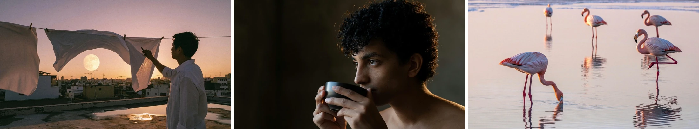

  

# Awesome MiniMax H3 Image Prompts

MiniMax H3 Image 图片、提示词与编辑参考，由 [BeatAPI](https://beatapi.io/zh) 整理。

**[网站案例库 · 待部署](https://beatapi.io/zh/minimax-h3-image-prompts)** · **[H3 视频案例库](https://github.com/BeatAPI/awesome-minimax-h3-prompts)** · **[English](./README.md)** · **[贡献案例](https://github.com/BeatAPI/awesome-minimax-h3-image-prompts/issues/new?template=prompt.yml)**

**25 组案例：2 组官方提示词流程 + 23 组作品展示。** 参考图不单独计数；未公开完整提示词的作品标为展示。

**按用途浏览：** [官方流程](./prompts/use-cases/official-workflows.md) · [摄影](./prompts/use-cases/photography.md) · [文字排版](./prompts/use-cases/typography.md) · [指令遵循](./prompts/use-cases/instruction-following.md) · [艺术与插画](./prompts/use-cases/art-illustration.md) · [提示词对比](./prompts/use-cases/prompt-comparison.md) · [图片编辑](./prompts/use-cases/image-editing.md) · [连续编辑](./prompts/use-cases/multi-turn-editing.md)

### 1. 农场餐桌 · 官方生成流程

[MiniMax](https://huggingface.co/MiniMaxAI/MiniMax-H3-Image)

<strong>原始提示词</strong>

~~~~text
A rustic, overhead shot of a farm-to-table feast, showcasing a variety of colorful, seasonal vegetables, artisanal cheeses, and freshly baked bread on a weathered wooden table.
~~~~

[官方扩写与生成流程](https://huggingface.co/MiniMaxAI/MiniMax-H3-Image#full-workflow)。图中保留本地部署与官方 API 的输出对照。

---

### 2. 播客碰拳 · 官方编辑流程

[MiniMax](https://huggingface.co/MiniMaxAI/MiniMax-H3-Image)

<strong>原始提示词</strong>

~~~~text
Take the over-ear headphones off the man on the left and fill in his hair where the band flattened it. Have both hosts lean toward each other and fist-bump directly above the "MONEY TALKS" desk sign, knuckles touching, elbows lifted off the desk, so the bump sits dead centre between the two microphones.
~~~~

[官方扩写与生成流程](https://huggingface.co/MiniMaxAI/MiniMax-H3-Image#full-workflow)。图中保留本地部署与官方 API 的输出对照。

参考输入

---

### 3. 成都菜市场 · 细节裁切

[@MinLiBuilds](https://x.com/MinLiBuilds/status/2120341428203311463)

原帖未公开完整提示词。

---

### 4. 人像 · 布料与皮肤细节

[@MinLiBuilds](https://x.com/MinLiBuilds/status/2120341428203311463)

原帖未公开完整提示词。

---

### 5. 梯田 · 超宽全景

[@MinLiBuilds](https://x.com/MinLiBuilds/status/2120341428203311463)

原帖未公开完整提示词。

---

### 6. 海报、菜单与信息排版

[@MinLiBuilds](https://x.com/MinLiBuilds/status/2120341428203311463)

原帖未公开完整提示词。

---

### 7. 计数、空间关系与属性绑定

[@MinLiBuilds](https://x.com/MinLiBuilds/status/2120341428203311463)

原帖未公开完整提示词。

---

### 8. 绘画、像素艺术与角色设定

[@MinLiBuilds](https://x.com/MinLiBuilds/status/2120341428203311463)

原帖未公开完整提示词。

---

### 9. 中文短提示与英文详细提示对比

[@MinLiBuilds](https://x.com/MinLiBuilds/status/2120341428203311463)

原帖未公开完整提示词。

---

### 10. 十张参考图布置客厅

[@MinLiBuilds](https://x.com/MinLiBuilds/status/2120341428203311463)

原帖未公开完整提示词。

参考输入

---

### 11. 白模转海岸实景

[@MinLiBuilds](https://x.com/MinLiBuilds/status/2120341428203311463)

原帖未公开完整提示词。

参考输入

---

### 12. 游戏地图转第一人称视角

[@MinLiBuilds](https://x.com/MinLiBuilds/status/2120341428203311463)

原帖未公开完整提示词。

参考输入

---

### 13. 人物、夹克与街景合成

[@MinLiBuilds](https://x.com/MinLiBuilds/status/2120341428203311463)

原帖未公开完整提示词。

参考输入

---

### 14. 海报文字与人物姿势编辑

[@MinLiBuilds](https://x.com/MinLiBuilds/status/2120341428203311463)

原帖未公开完整提示词。

---

### 15. 连续换装编辑 · 模型对比

[@MinLiBuilds](https://x.com/MinLiBuilds/status/2120341428203311463)

原帖未公开完整提示词。

MiniMax H3 Image / Seedream 5.5 / GPT Image 2.5

---

### 16. 秒针移动 · 连续编辑

[@MinLiBuilds](https://x.com/MinLiBuilds/status/2120341428203311463)

原帖未公开完整提示词。

---

### 17. 写实摄影

[MiniMax](https://huggingface.co/MiniMaxAI/MiniMax-H3-Image)

原帖未公开完整提示词。

---

### 18. 超现实创意摄影

[MiniMax](https://huggingface.co/MiniMaxAI/MiniMax-H3-Image)

原帖未公开完整提示词。

---

### 19. 环境概念设计

[MiniMax](https://huggingface.co/MiniMaxAI/MiniMax-H3-Image)

原帖未公开完整提示词。

---

### 20. 角色、生物与道具

[MiniMax](https://huggingface.co/MiniMaxAI/MiniMax-H3-Image)

原帖未公开完整提示词。

---

### 21. 绘画与插画

[MiniMax](https://huggingface.co/MiniMaxAI/MiniMax-H3-Image)

原帖未公开完整提示词。

---

### 22. 逻辑题与文字渲染

[MiniMax](https://huggingface.co/MiniMaxAI/MiniMax-H3-Image)

原帖未公开完整提示词。

---

### 23. 月球基地 · 白模转电影画面

[MiniMax](https://huggingface.co/MiniMaxAI/MiniMax-H3-Image)

原帖未公开完整提示词。

---

### 24. 地图转游戏视角

[MiniMax](https://huggingface.co/MiniMaxAI/MiniMax-H3-Image)

原帖未公开完整提示词。

---

### 25. 客厅 · 十图参考合成

[MiniMax](https://huggingface.co/MiniMaxAI/MiniMax-H3-Image)

原帖未公开完整提示词。

---

## 相关资源

- [MiniMax H3 Image](https://huggingface.co/MiniMaxAI/MiniMax-H3-Image)
- [Seedream 5.5 gallery](https://beatapi.io/zh/seedream-5-5-prompts)
- [GPT Image 2.6 gallery](https://beatapi.io/zh/gpt-image-2-6-prompts)
- [BeatAPI image models](https://beatapi.io/zh/models)

## 素材与许可

图片已转换为 WebP 并托管于 BeatAPI。原作者保留图片与提示词的权利；本仓库不主张获得了额外转载授权。模型权重许可请看官方仓库。案例来自原作者公开展示，非 BeatAPI 独立复测。
